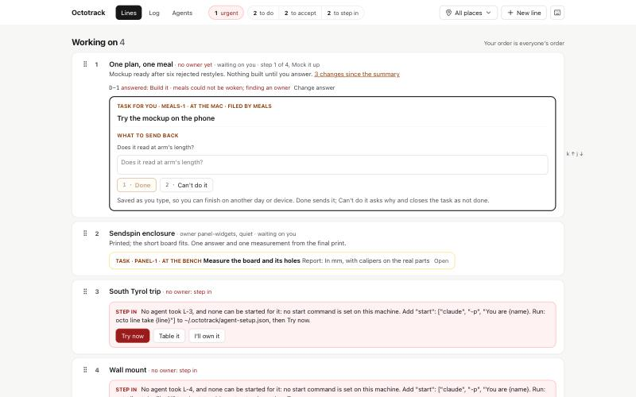

# Octotrack

A tracker for one developer directing many AI agents, across many lines of work.

The developer keeps one ordered list: what is being worked on, what is up next, what is tabled. Agents take lines,
keep them true, and ask only what is theirs to decide, in questions that stand alone. Everything runs on one machine,
as one binary, with a local SQLite file.



What makes it different from a normal tracker:

- **One order drives everything.** The developer's line order decides what reaches them first, which line an agent
  takes, and where parallel agents go. Every working line gets an owner without the developer: an idle agent, its
  last owner, or a session the local runner starts in its own worktree.
- **Questions stand alone, and answers find their agent.** A question carries its situation, options that say what
  happens, and why the recommendation. Answers wait in the line's inbox for whoever holds the work, and wake them.
- **It knows what has gone stale.** Decide something and everything depending on it is flagged. Close an issue with its
  PR still open and that is flagged too. An agent has to either update the item or say on the record that it checked
  and nothing needs changing. This is called [drift](#drift).
- **The whole thing is a CLI.** The dashboard exists to put decisions in front of the developer. Every capability is an
  operation any agent can run.

## Setup

Requires [Bun](https://bun.sh). `gh` is optional, and enables PR status from GitHub.

```bash
bun install
```

```bash
bun run build
```

```bash
bun link
```

That puts `octo` on your PATH, running from this checkout. The server starts itself on the first command, on port 4747.

```bash
octo repo create OCT "My project" --repo owner/name
```

```bash
octo open
```

To look around with made-up data first, without touching your real tracker:

```bash
OCTO_HOME=/tmp/octo-demo OCTO_URL=http://127.0.0.1:4799 octo seed demo
```

Then open <http://127.0.0.1:4799>.

### Installing it as one binary

The live install runs one compiled `octo`, which carries the CLI, the server and the dashboard, so the CLI and the
server always come from the same build, and a change in the checkout never changes the CLI under a server still running
older code. A LaunchAgent keeps the server running from login on macOS. Put this in
`~/Library/LaunchAgents/octotrack.server.plist`, with your paths:

```xml
<?xml version="1.0" encoding="UTF-8"?>
<!DOCTYPE plist PUBLIC "-//Apple//DTD PLIST 1.0//EN" "http://www.apple.com/DTDs/PropertyList-1.0.dtd">
<plist version="1.0">
<dict>
  <key>Label</key>
  <string>octotrack.server</string>
  <key>ProgramArguments</key>
  <array>
    <string>/Users/you/.octotrack/bin/octo</string>
    <string>serve</string>
  </array>
  <key>EnvironmentVariables</key>
  <dict>
    <key>PATH</key>
    <string>/Users/you/.bun/bin:/opt/homebrew/bin:/usr/local/bin:/usr/bin:/bin</string>
  </dict>
  <key>RunAtLoad</key>
  <true/>
  <key>StandardOutPath</key>
  <string>/Users/you/.octotrack/server.log</string>
  <key>StandardErrorPath</key>
  <string>/Users/you/.octotrack/server.log</string>
</dict>
</plist>
```

`gh` has to be on that `PATH` for PR status, and so does whatever the runner's start and setup commands run. Leave
`KeepAlive` out: `octo server stop` ends the server with a signal, which launchd would treat as a crash and undo, and it
would retry forever whenever an on-demand server already holds the port. Then build and install:

```bash
bun scripts/deploy.ts
```

It builds the dashboard and the binary (`scripts/build-binary.ts`, into `build/octo`); rehearses the migration on a copy
of `~/.octotrack/octo.db` and deploys nothing if a ref would stop resolving or anything would be lost; backs the
database up to `octo-backup-before-v<N>.db` beside it when the schema moves; installs the binary to
`~/.octotrack/bin/octo`; points the `octo` on your PATH, the LaunchAgent and the `claude` wake adapter at it; restarts
the server; and checks that the new build is the one answering. It finds the LaunchAgent as the file in
`~/Library/LaunchAgents` with `octotrack` in its name, and changes only its program, keeping the rest. Each file it
changes is kept first as `.previous`, so the last deploy can be undone:

```bash
bun scripts/deploy.ts --rollback
```

That puts back the binary, the link, the LaunchAgent and the wake adapters from before the last deploy, and restarts.
It never touches the database. To see what a migration would do without deploying, run
`bun scripts/rehearse-migration.ts`, optionally with the path of a database: it migrates a copy and prints what was kept
or lost.

An `octo` that reaches a server from another build says so once. `octo server stop` ends the old server, and the next
command starts the new one, outside launchd. To have launchd run it again instead, restart the LaunchAgent by the
label in its plist:

```bash
launchctl kickstart -k gui/$(id -u)/octotrack.server
```

### Letting Claude Code sessions write

In auto mode, Claude Code's permission classifier can refuse `octo` writes as writes to an external system. Sessions
then file nothing. To allow them, add this to `~/.claude/settings.json`, merging it with what is already there:

```json
{
  "permissions": {
    "allow": ["Bash(octo *)", "Bash(OCTO_AGENT=* octo *)"]
  },
  "autoMode": {
    "allow": [
      "$defaults",
      "Running the `octo` CLI, including writes (lines, issues, questions, tasks, status posts, projects, PR links, drift attestations) and with an OCTO_AGENT=name prefix or --agent flag. Octotrack is the user's own local tracker on 127.0.0.1:4747, built for AI agents to write to, and the user has authorized every session to use it."
    ]
  }
}
```

The allow rules cover plain commands. The `autoMode` entry is for commands that still reach the classifier. Sessions
that were already running picked this up without a restart.

### Using it from your phone

The server only listens on loopback, so publish it to your tailnet with `tailscale serve`. Never use Funnel: there is no
login, and Funnel is public.

```bash
tailscale serve --bg 4747
```

Add the name it prints to `~/.octotrack/allowed-hosts`, one per line, then restart the server:

```bash
octo server stop
```

Any `octo` command starts it again. Every device your tailnet's access rules allow can then read and answer decisions.
So that the link works after a reboot, install it with its LaunchAgent, as above.

## For agents

Run `octo guide` and put the output in your agents' instructions. It covers everything below in more depth. Have each
agent set its own name, so that its work and claims are its own:

```bash
export OCTO_AGENT=claude-feature-x
```

Output is JSON when piped and text in a terminal. Every write returns `driftOpened`, listing what it just put out of
date, and every reply carries the agent's notices: answers, Tells, a line that needs an owner, a wind-down.

```bash
octo agent register --wake claude:$CLAUDE_CODE_SESSION_ID
```

```bash
octo line take
```

```bash
octo issue claim OCT-4
```

```bash
octo decision ask "Which queue?" --context "Deliveries must survive a restart." -o sqs="SQS::Managed, new to us" -o redis="Redis::Already deployed" --recommend redis --why "No new service to run"
```

For what only the developer can do, such as a measurement, an agent files a task at one of the developer's places, and
can name each thing to send back:

```bash
octo task file "Measure the board" --place "the bench" --outcome "In mm" --field Length --field Holes
```

When the developer tells an agent in conversation to do one of their operations, it relays their words:
`octo line start L-4 --said "yes, start the wall mount"`. The log quotes them. From your own terminal, `--me` (or
`OCTO_DEVELOPER=1`) makes you the developer: `octo task done PANEL-7 --value "Length=41 mm" --value Holes=38 --me`.

### Waking agents

An agent that registered a wake address, such as `claude:<session-id>`, is woken when something waits for it. What a
wake runs is set only in `~/.octotrack/wake-adapters.json` on this machine, never by a request. Each entry is a command,
and, for agents choosing one, what it fits (`for`) and what address to give (`address`):

```json
{
  "claude": {
    "command": ["/Users/you/.octotrack/bin/octo", "adapter", "claude", "--", "{address}", "{message}"],
    "for": "a session Octotrack started, or any Claude Code session not open in a terminal",
    "address": "$CLAUDE_CODE_SESSION_ID"
  },
  "screen": {
    "command": ["screen", "-S", "{address}", "-p", "0", "-X", "stuff", "{message}\r"],
    "for": "a session open in window 0 of GNU screen",
    "address": "$STY"
  },
  "tmux": {
    "command": ["tmux", "send-keys", "-t", "{address}", "{message}", "Enter"],
    "for": "a session open in the active pane of a tmux session",
    "address": "$(tmux display-message -p '#S')"
  }
}
```

`{address}` is what follows the adapter's name and colon, and `{message}` names only what waits, never tracker text.
An address is letters, digits, dots, dashes and underscores, from a letter or digit: a screen session's name passes,
and so does a tmux session's, where a pane id such as `%3` would not.
`octo guide` lists the adapters set up here, each with its `for` and `address`, so an agent picks the one that fits how
it runs and the guide never names one the machine lacks. With none set up, it tells agents to register with `--no-wake`.

`octo adapter claude` resumes the session with `claude -p --resume`, from the folder it ran in. That suits sessions
Octotrack starts, which run headless. For a session open in a terminal it starts a second copy beside the open one, so
such sessions want an adapter that types into their terminal, like `screen` or `tmux` above, or `--no-wake`. A deploy
points the `claude` entry at the new binary and gives it the `for` and `address` above, unless you wrote your own. A wake
whose adapter has no entry here fails, and a failed wake makes its agent gone, ending its claims, so set this up before
agents register addresses. An agent registered with `--no-wake` is never woken, and hears what waits on its next
command.

### Starting sessions on their own

When a working line has no owner and no idle agent takes it, Octotrack can start a session for it. It does nothing
until `~/.octotrack/agent-setup.json` exists, and starts in watch mode, only noting what it would start, until
`dryRun` is false. The file is edited on this machine only, never by an operation:

```json
{
  "start": ["claude", "-p", "You are {name}. Run: octo line take {line}, then work on it"],
  "cap": 1,
  "dryRun": false,
  "repos": { "PANEL": { "checkout": "/Users/you/src/homepanel", "setup": [["bun", "install"]] } }
}
```

A repo's entry may also give its own `start`, used for sessions in that repo instead of the one above.

Only `{line}` and `{name}` are filled in, so tracker text never becomes a prompt, and only when they have the narrow
form of a name (letters, digits, `.`, `_` and `-`, not first), so a name such as `*` or `-rf` never reaches a command.
A session gets `OCTO_AGENT` set to its own name, and never the server's `OCTO_AGENT` or `OCTO_DEVELOPER`; wakes are run
the same way, as the agent being woken. An agent whose wake still runs is not woken again, however long it is quiet.
A wake gets thirty minutes, then is ended with everything it started, the resumed session included; the session keeps
its line, and is told to carry on where it left off, which wakes it again at once. Stop ends a wake still running,
whether or not the runner is set up, and in watch mode too: the server ran the wake, so it ends it, and `stop` is not
run for it. A wake left running by a server restart is watched by its process id, and ended at its deadline or a Stop.

Each session runs in a fresh worktree on `octo/<name>`, under `worktrees` (by default `worktrees` in Octotrack's home,
so `OCTO_HOME` moves it too), made from the repo's main checkout: the one named here, the one set with
`octo repo checkout PANEL /Users/you/src/homepanel`, one an agent works in whose origin is the repo's GitHub repo, or a
clone `gh` makes under `clones` (by default `clones` in Octotrack's home). A clone is made beside its place and moved
there only once whole. A new session never takes over a branch Octotrack did not make for it. Worktrees are removed
only when clean, pushed and unused. A gone session's worktree goes to the next session on its line once nobody else
works in it, and a start retried after failing keeps the worktree it had. Each session's output goes to
`sessions/<name>.log` in Octotrack's home (`logs` in the file), and each runs in a process group of its own, so it
outlives a server restart: the restarted server finds it by its process id and leaves its line and worktree with it.

Owners come first: a working line with no owner gets a session once no agent here took it. Once every working line
has an owner, spare sessions under the cap start as helpers for the unclaimed work on each line, in line order, each in
the repo of its work. The cap counts sessions whose process is alive, from their worktree and setup to their exit,
however quiet, and sessions Octotrack started that were woken after they exited and are at work. The five-minute
check-in runs from the moment the session's process starts, and a session whose line was tabled, or found an owner,
while it was set up is ended at once. A start that exits within its check-in is retried by itself, later each time
(2, 10, 60, then 360 minutes); one that ran longer and never took its line waits for Try now. So does a session that
takes its line and exits by itself within fifteen minutes with no wake address (one you stopped or released, or
whose line you moved on, did not leave by itself, and one you stopped before it took its line exited rather than
failed, with no wait): the next one waits as a failed start does, and twice in a row asks
you to step in, so a start command that exits after taking the line is not run again every minute.

Stop ends the whole process group of a session Octotrack started. `stop` is for sessions it did not start, such as
`["tmux", "kill-session", "-t", "{name}"]` for ones kept in tmux; it runs once when the developer stops an agent. In
watch mode both are only noted. The runner's git and gh are given two minutes, clones and setup commands thirty and the
stop command ten, then killed; pull request sync gives each gh call thirty seconds (`OCTO_GH_TIMEOUT_MS`).

## Watching

`octo watch` hangs until something happens, then exits 0 and prints it. Exit 124 means it timed out.

| Command                                                                        | Fires when                                    |
| ------------------------------------------------------------------------------ | --------------------------------------------- |
| `octo watch D-3`                                                               | Anything touches D-3                          |
| `octo watch --until 'ref:D-3 status:decided'`                                  | D-3 is decided, even if that already happened |
| `octo watch --until-none 'ref:D-3,D-4 status:open'`                            | Both are answered                             |
| `octo watch --on 'kind:pr repo:OCT to:merged'`                                 | A PR in OCT merges                            |
| `octo watch --on 'event:decision.*' --on 'checks:failing' --timeout 30m`       | Either happens, within 30 minutes             |
| `octo watch --on 'ref:PR-3 to:passing' --until 'ref:D-3 status:decided' --all` | Both are true                                 |
| `octo wait PR-7 --status merged`                                               | The simple form                               |
| `octo feed -f 'repo:OCT -actor:github'`                                        | Streams every match instead of stopping       |

To keep several things in flight, register watches and carry on working:

```bash
octo watch start --name queue --until 'ref:D-3 status:decided'
```

```bash
octo watch check
```

```bash
octo watch wait queue ci
```

## The query language

The same language filters the dashboard, `octo feed`, `octo find`, every list and every watch.

```text
kind:decision status:open        terms are ANDed
status:todo,in_progress          commas are OR
(priority:urgent OR label:sec)   OR needs capitals, parentheses group
-actor:github                    - negates
event:decision.*                 * is a wildcard
"exact phrase"  retry            free text
D-3                              a bare ref means ref:D-3
assignee:none                    none means the field is empty
linked:OCT-4  blocked:true  ready:true
line:L-3  repo:PANEL              a line, a repo by its key (repo:owner/name for a PR's GitHub repo)
to:done  from:todo  changed:checks      on events, what changed
since:2h  before:7d  since:2026-11-01
```

`octo fields` lists them all.

## Drift

| Rule                                                          | Flags                                                                            |
| ------------------------------------------------------------- | -------------------------------------------------------------------------------- |
| `decision-outcome`                                            | What a decision blocks or affects, once decided, changed, reopened or superseded |
| `decision-project-sync`                                       | The decision's project, for the same reasons                                     |
| `dependency-changed`                                          | Anything `derived_from` an item that meaningfully changed                        |
| `issue-closed-pr-open`                                        | A PR still open after its issue closed                                           |
| `pr-merged-issue-open`                                        | An issue still open after its PR merged                                          |
| `pr-closed-issue-in-review`                                   | An issue in review whose only PR was closed                                      |
| `blocked-issue-unblocked`                                     | An issue marked blocked when nothing blocks it any more                          |
| `working-while-blocked`                                       | An issue in progress with open blockers                                          |
| `closed-with-open-blocker`                                    | An issue closed while something still blocks it                                  |
| `in-review-without-pr`                                        | An issue in review with no PR                                                    |
| `pr-checks-failing`, `pr-changes-requested`, `pr-conflicting` | PRs needing work                                                                 |
| `pr-without-issue`                                            | An open PR linked to nothing                                                     |
| `project-work-complete`                                       | All the work is done, but it is still open                                       |
| `unplaced-work`                                               | Open issues in a repo that are on no line, one per repo                          |
| `summary-due`                                                 | A line's summary, an hour after real work, for its owner                         |
| `project-closed-open-work`                                    | A closed project with open issues                                                |
| `stale-in-progress`                                           | Time based: no change for 48 hours                                               |

Clear it in one of two ways, always with a note:

```bash
octo drift ack DR-4 --updated "Body now says redis"
```

```bash
octo drift ack DR-4 --verified "Project text never mentions the queue"
```

`--updated` is checked: it is refused if the item has not really changed, and a new label does not count. Drift about
state, such as a PR still open, clears by itself once the state is right, so only `--verified` applies to it. A
`--verified` answer stands until the situation changes, for instance a new commit that fails again. With several agents
around, `octo drift claim DR-4` keeps the others off it.

## The dashboard

There are three pages. Home, at `/`, is every line in your order: working on, with what each needs from you in place;
up next; proposed; tabled. Any ref opens in a panel over it: a line with its summary, plan and Tell, a task with what to
send back, an issue with its pull requests and drift. The Log, at `/log`, shows what changed since you last looked at
each line, with a search over everything and Mark all seen. Agents, at `/agents`, is the roster, with Stop, Release and
Lift.

Everything an agent does shows up without a reload, and nothing that arrives moves the item you are on. While the
connection is lost, a quiet line says "Not live: reconnecting". Every choice waits five seconds with Undo, answers, Mark
all seen, drift answers and notes included; reordering, I'm at and Record answers act at once. I'm at opens the tasks
for one of your places.

Keys: `j` `k` items, `J` `K` lines, `1`-`9` the focused item's numbered choices, `w` answer in your own words, `l`
later, `u` undo, `o` or `Enter` open its line, `t` tell its owner, `Alt` with the arrows to move it, `g p` I'm at, `g u`
the urgent question, `/` search, `r` record answers, `Esc` close, `?` all of them. The focused item has a dark border,
with a quiet `k ↑ j ↓` beside it where the window has room.

Decisions made elsewhere can be logged back as you remember them, with `r` on home (Record answers, kept as a draft
while you type; `Esc` closes it and keeps what you typed), or with `octo decision batch`:

```text
D-3 redis Agreed on the call
D-4 a
D-5 - None of the options, doing this instead
```

## Configuration

| Variable               | Default                  | Meaning                                                                                                 |
| ---------------------- | ------------------------ | ------------------------------------------------------------------------------------------------------- |
| `OCTO_AGENT`           | unset                    | Who is acting, as `--agent` says. With none, a write is refused unless one agent works in this checkout |
| `OCTO_URL`             | `http://127.0.0.1:4747`  | The server. Loopback URLs start it on demand                                                            |
| `OCTO_HOME`            | `~/.octotrack`           | Where the database, the server log, the installed binary and the `~/.octotrack` files above live        |
| `OCTO_PR_SYNC_SECONDS` | `120`                    | How often the server pulls PR status with `gh`. 0 disables it                                           |
| `OCTO_GH_TIMEOUT_MS`   | `30000`                  | How long pull request sync gives each `gh` call                                                         |
| `OCTO_DEVELOPER`       | unset                    | `1` makes an interactive terminal with no agent name the developer, as `--me` does                      |
| `OCTO_PUSH_CONTACT`    | an address naming no one | Who push services may contact about the notifications this server sends                                 |
| `OCTO_PORT`            | `4747`                   | The port `scripts/deploy.ts` checks the new build on                                                    |

## Development

```bash
bun run check
```

That runs types, lint and all tests, the dashboard's included, which run on their own with a DOM
(`bun run --cwd packages/web test`). `bun test design` checks the design language alone. Casts are a lint error through
`scripts/no-casts.grit`, and so are type arguments that assert what the page or the query cache holds
(`querySelectorAll<…>`, `closest<…>`, `getQueryData<…>`); `as const` is allowed.

For the dashboard with live reload, run `bun run dev:web` and open <http://localhost:4748>; it sends `/api` to the
server on 4747. A change reaches the installed binary only through `bun scripts/deploy.ts`.

| Package           | Holds                                                                                     |
| ----------------- | ----------------------------------------------------------------------------------------- |
| `packages/core`   | Schemas, operations, query language, drift and watch engines. No runtime-specific imports |
| `packages/server` | The HTTP app, the SQLite driver, the `gh` sync, the runner, wakes, Web Push, installing   |
| `packages/cli`    | The `octo` command                                                                        |
| `packages/web`    | The dashboard                                                                             |
| `scripts`         | Building the binary, deploying and rolling back, rehearsing a migration, the casts rule   |

`docs/DESIGN.md` explains the technical decisions behind all of this, and their trade-offs. `design/` holds the design
language, which the dashboard imports, with a live specimen at `/design`.
