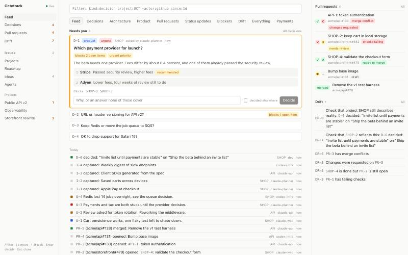

# Octotrack

A project tracker for one developer directing many AI agents, across many projects.

Agents write through a CLI. The developer reads one feed and makes the decisions that unblock them, as the senior
developer, architect and product manager. Everything runs on one machine with a local SQLite file.



What makes it different from a normal tracker:

- **Agents can hang on a decision.** `octo decision ask ... --wait` blocks until the developer answers, and survives
  server restarts. The dashboard shows who is waiting, and ranks those decisions higher.
- **It knows what has gone stale.** Decide something and everything depending on it is flagged. Close an issue with its
  PR still open and that is flagged too. An agent has to either update the item or say on the record that it checked
  and nothing needs changing. This is called [drift](#drift).
- **The whole thing is a CLI.** The dashboard exists to put decisions in front of the developer. Every capability is an
  operation any agent can run.

## Setup

Requires [Bun](https://bun.sh). `gh` is optional, and enables PR status from GitHub.

```bash
bun install
```

```bash
bun run build
```

```bash
bun link
```

That puts `octo` on your PATH. The server starts itself on the first command.

```bash
octo project create OCT "My project" --repo owner/name
```

```bash
octo open
```

To look around with made-up data first, without touching your real tracker:

```bash
OCTO_HOME=/tmp/octo-demo OCTO_URL=http://127.0.0.1:4799 octo seed demo
```

Then open <http://127.0.0.1:4799>.

### Letting Claude Code sessions write

In auto mode, Claude Code's permission classifier can refuse `octo` writes as writes to an external system. Sessions then
file nothing. To allow them, add this to `~/.claude/settings.json`, merging it with what is already there:

```json
{
  "permissions": {
    "allow": ["Bash(octo *)", "Bash(OCTO_AGENT=* octo *)"]
  },
  "autoMode": {
    "allow": [
      "$defaults",
      "Running the `octo` CLI, including writes (issues, decisions, status posts, ideas, projects, PR links, drift attestations) and with an OCTO_AGENT=name prefix or --agent flag. Octotrack is the user's own local tracker on 127.0.0.1:4747, built for AI agents to write to, and the user has authorized every session to use it."
    ]
  }
}
```

The allow rules cover plain commands. The `autoMode` entry is for commands that still reach the classifier. Sessions that
were already running picked this up without a restart.

### Waking an agent when its decision is answered

An agent that asks with `--wake adapter:address` is woken by the server when the decision is answered. What a wake runs
comes only from `~/.octotrack/wake-adapters.json`. `{address}` is replaced by the address and `{message}` by the wake
message, which holds only the decision's ref:

```json
{
  "screen": { "command": ["screen", "-S", "{address}", "-p", "0", "-X", "stuff", "{message}\r"] },
  "claude": {
    "command": ["bun", "/path/to/octotrack/packages/server/src/adapters/claude.ts", "{address}", "{message}"]
  }
}
```

- `screen` types the message into window 0 of a GNU screen session, followed by Enter. An agent running there
  receives it as input, as if the developer had typed it, whether it is busy or idle. Agents ask with
  `--wake screen:$STY`.
- `claude` resumes a Claude Code session headlessly with `claude -p --resume`. Use it only for sessions that are not
  open in a terminal: for one that is, it starts a second copy of the session.

The server reads the file when it starts, so run `octo server stop` after changing it.

### Using it from your phone

The server only listens on loopback, so publish it to your tailnet with `tailscale serve`. Never use Funnel: there is no
login, and Funnel is public.

```bash
tailscale serve --bg 4747
```

Add the name it prints to `~/.octotrack/allowed-hosts`, one per line, then restart the server:

```bash
octo server stop
```

Any `octo` command starts it again. Every device your tailnet's access rules allow can then read and answer decisions.

So that the link works after a reboot, have the server start at login on macOS. Put this in
`~/Library/LaunchAgents/octotrack.server.plist`, with your paths, then load it with
`launchctl bootstrap gui/$(id -u) ~/Library/LaunchAgents/octotrack.server.plist`:

```xml
<?xml version="1.0" encoding="UTF-8"?>
<!DOCTYPE plist PUBLIC "-//Apple//DTD PLIST 1.0//EN" "http://www.apple.com/DTDs/PropertyList-1.0.dtd">
<plist version="1.0">
<dict>
  <key>Label</key>
  <string>octotrack.server</string>
  <key>ProgramArguments</key>
  <array>
    <string>/Users/you/.bun/bin/bun</string>
    <string>/Users/you/.bun/bin/octo</string>
    <string>serve</string>
  </array>
  <key>EnvironmentVariables</key>
  <dict>
    <key>PATH</key>
    <string>/Users/you/.bun/bin:/opt/homebrew/bin:/usr/local/bin:/usr/bin:/bin</string>
  </dict>
  <key>RunAtLoad</key>
  <true/>
  <key>StandardOutPath</key>
  <string>/Users/you/.octotrack/server.log</string>
  <key>StandardErrorPath</key>
  <string>/Users/you/.octotrack/server.log</string>
</dict>
</plist>
```

`gh` has to be on that `PATH` for PR status. Leave `KeepAlive` out: `octo server stop` ends the server with a signal, which
launchd would treat as a crash and undo, and it would retry forever whenever an on-demand server already holds the port.

## For agents

Run `octo guide` and put the output in your agents' instructions. It covers everything below in more depth. Have each
agent set its own name, so that its work and claims are its own:

```bash
export OCTO_AGENT=claude-feature-x
```

Output is JSON when piped and text in a terminal. Every write returns `driftOpened`, listing what it just put out of
date.

```bash
octo next
```

```bash
octo issue claim OCT-4
```

```bash
octo decision ask "Which queue?" -p OCT --kind architecture -o sqs=SQS -o redis="Redis::Already deployed" --recommend redis --blocks OCT-4 --wait
```

## Watching

`octo watch` hangs until something happens, then exits 0 and prints it. Exit 124 means it timed out.

| Command                                                                        | Fires when                                    |
| ------------------------------------------------------------------------------ | --------------------------------------------- |
| `octo watch D-3`                                                               | Anything touches D-3                          |
| `octo watch --until 'ref:D-3 status:decided'`                                  | D-3 is decided, even if that already happened |
| `octo watch --until-none 'ref:D-3,D-4 status:open'`                            | Both are answered                             |
| `octo watch --on 'kind:pr project:OCT to:merged'`                              | A PR in OCT merges                            |
| `octo watch --on 'event:decision.*' --on 'checks:failing' --timeout 30m`       | Either happens, within 30 minutes             |
| `octo watch --on 'ref:PR-3 to:passing' --until 'ref:D-3 status:decided' --all` | Both are true                                 |
| `octo wait PR-7 --status merged`                                               | The simple form                               |
| `octo feed -f 'project:OCT -actor:github'`                                     | Streams every match instead of stopping       |

To keep several things in flight, register watches and carry on working:

```bash
octo watch start --name queue --until 'ref:D-3 status:decided'
```

```bash
octo watch check
```

```bash
octo watch wait queue ci
```

## The query language

The same language filters the dashboard, `octo feed`, `octo find`, every list and every watch.

```text
kind:decision status:open        terms are ANDed
status:todo,in_progress          commas are OR
(priority:urgent OR label:sec)   OR needs capitals, parentheses group
-actor:github                    - negates
event:decision.*                 * is a wildcard
"exact phrase"  retry            free text
D-3                              a bare ref means ref:D-3
assignee:none                    none means the field is empty
linked:OCT-4  blocked:true  ready:true
to:done  from:todo  changed:checks      on events, what changed
since:2h  before:7d  since:2026-11-01
```

`octo fields` lists them all.

## Drift

| Rule                                                          | Flags                                                                            |
| ------------------------------------------------------------- | -------------------------------------------------------------------------------- |
| `decision-outcome`                                            | What a decision blocks or affects, once decided, changed, reopened or superseded |
| `decision-project-sync`                                       | The decision's project, for the same reasons                                     |
| `dependency-changed`                                          | Anything `derived_from` an item that meaningfully changed                        |
| `issue-closed-pr-open`                                        | A PR still open after its issue closed                                           |
| `pr-merged-issue-open`                                        | An issue still open after its PR merged                                          |
| `pr-closed-issue-in-review`                                   | An issue in review whose only PR was closed                                      |
| `blocked-issue-unblocked`                                     | An issue marked blocked when nothing blocks it any more                          |
| `working-while-blocked`                                       | An issue in progress with open blockers                                          |
| `closed-with-open-blocker`                                    | An issue closed while something still blocks it                                  |
| `in-review-without-pr`                                        | An issue in review with no PR                                                    |
| `pr-checks-failing`, `pr-changes-requested`, `pr-conflicting` | PRs needing work                                                                 |
| `pr-without-issue`                                            | An open PR linked to nothing                                                     |
| `milestone-complete`, `project-work-complete`                 | All the work is done, but it is still open                                       |
| `project-closed-open-work`                                    | A closed project with open issues                                                |
| `milestone-overdue`, `stale-in-progress`                      | Time based: past its date, or no change for 48 hours                             |

Clear it in one of two ways, always with a note:

```bash
octo drift ack DR-4 --updated "Body now says redis"
```

```bash
octo drift ack DR-4 --verified "Project text never mentions the queue"
```

`--updated` is checked: it is refused if the item has not really changed, and a new label does not count. Drift about
state, such as a PR still open, clears by itself once the state is right, so only `--verified` applies to it. A
`--verified` answer stands until the situation changes, for instance a new commit that fails again. With several agents
around, `octo drift claim DR-4` keeps the others off it.

## The dashboard

Everything an agent does through the CLI shows up without a reload. The decision you have open stays open while the
queue re-ranks around it.

Keys: `/` filter, `j` `k` move between decisions, `1`-`9` pick an option, `Enter` decide, `Esc` close the inspector.

Decisions made elsewhere can be logged back as you remember them, on the Decisions page or with `octo decision batch`:

```text
D-3 redis Agreed on the call
D-4 a
D-5 - None of the options, doing this instead
```

## Configuration

| Variable               | Default                 | Meaning                                                       |
| ---------------------- | ----------------------- | ------------------------------------------------------------- |
| `OCTO_AGENT`           | `agent`                 | Who is acting                                                 |
| `OCTO_URL`             | `http://127.0.0.1:4747` | The server. Loopback URLs start it on demand                  |
| `OCTO_HOME`            | `~/.octotrack`          | Where the database and server log live                        |
| `OCTO_PR_SYNC_SECONDS` | `120`                   | How often the server pulls PR status with `gh`. 0 disables it |

## Development

```bash
bun run check
```

That runs types, lint and all tests. Casts are a lint error through `scripts/no-casts.grit`, and `as const` is allowed.

| Package           | Holds                                                                                     |
| ----------------- | ----------------------------------------------------------------------------------------- |
| `packages/core`   | Schemas, operations, query language, drift and watch engines. No runtime-specific imports |
| `packages/server` | The HTTP app, the SQLite driver and the `gh` sync                                         |
| `packages/cli`    | The `octo` command                                                                        |
| `packages/web`    | The dashboard                                                                             |

`docs/DESIGN.md` explains the technical decisions behind all of this, and their trade-offs. `design/` holds the design
language, which the dashboard imports, with a live specimen at `/design`.
